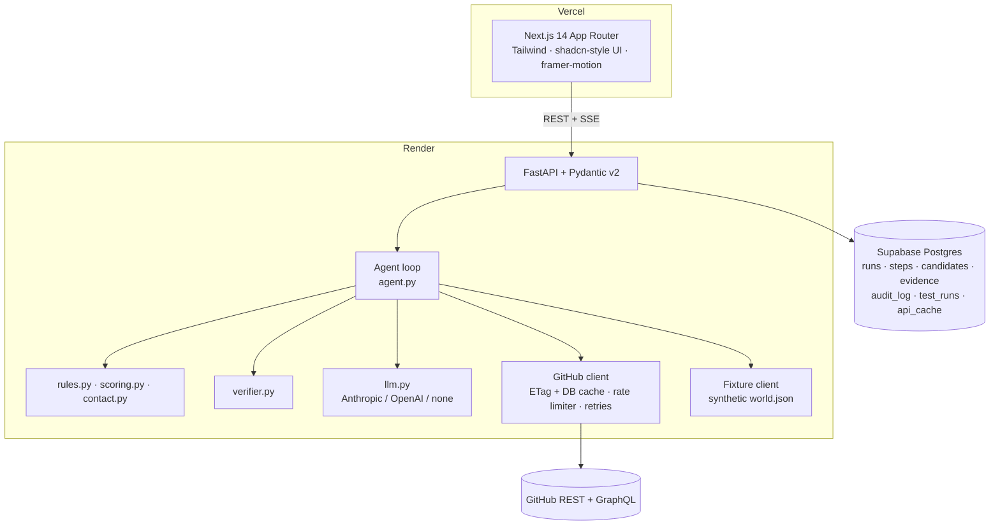

# Open-Source Contributor Sourcer

> An AI agent that finds developers with **real, recent public contributions** in a technology. It returns a shortlist where every claim links to its evidence, every cited PR is **independently re-verified**, and nothing is final until a **human approves** it.

Built for the **Ziro Agentic AI Hackathon 2026** (Developer & Enterprise AI track).

**Live demo:** https://contributor-sourcer.onrender.com · API https://contributor-sourcer-api.onrender.com/docs · [Official test cases](https://contributor-sourcer.onrender.com/tests) · [Deck](https://contributor-sourcer.onrender.com/deck) · [Demo video](https://contributor-sourcer.onrender.com/demo)

> These run on the free hosting tier. If the site has been idle, the first load can take about 30 seconds while the API wakes up. The header shows *"Waking API…"* and retries automatically.

---

## The problem

Recruiters source developers from profiles, keywords and follower counts. These signals are easy to inflate and hard to check. A fork with 40 commits looks like activity. A famous name from 2021 looks current. An email guessed from a commit header becomes a GDPR problem.

**This agent starts from merged contributions instead of profiles.** It applies explicit, testable rules to decide what counts, and it shows its reasoning at every step.

## What it does

| Brief requirement | How it is implemented |
|---|---|
| Collect details: skills and recency | A natural-language request goes to the **LLM planner**, which produces editable structured criteria (languages, keywords, seed repos, profiles to vet, window, minimum PRs, location preference). |
| Plan: judge public contributions only | `rules.py` contains **deterministic** decision rules. The LLM never decides who qualifies. |
| Find: public code-hosting profiles | The official **GitHub REST and GraphQL APIs**: merged-PR search, all-time contributors of seed repos, and per-profile PR history with each base repo's fork status. |
| Take action: compile shortlist, with human approval required | The agent produces a `PENDING_APPROVAL` **draft**. A named human approves or rejects each candidate, then clicks **Approve & finalise**. The action is audited and can be undone until export. Exports are CSV, JSON or a read-only share link. |
| Verify: repos and activity | `verifier.py` is a separate module and a separate step. It **re-fetches every cited PR via REST** and checks: resolves, merged, in window, author matches, upstream not a fork. Failures block approval. |
| Output: shortlist with evidence | Each candidate has PR links, rule checks, verification stamps, a score breakdown and a summary whose URLs are checked against the evidence. |

## The agent loop

```mermaid
flowchart LR
    U[Recruiter request] --> P[Plan<br/>LLM → Criteria]
    P -->|recruiter edits & runs| S[Search<br/>merged PRs in window<br/>+ seed-repo contributors<br/>+ vet list]
    S --> E[Enrich<br/>GraphQL profile + PRs<br/>+ base-repo fork status]
    E --> C[Classify<br/>deterministic rules]
    C --> A{Adapt<br/>enough shortlisted?}
    A -->|no: widen WHERE it looks| S
    A -->|yes / budget used| SC[Score<br/>0–100 breakdown]
    SC --> X[Explain<br/>LLM summary from evidence JSON<br/>uncited URLs stripped]
    X --> V[Verify<br/>independent REST re-fetch]
    V --> PR[Propose draft<br/>PENDING_APPROVAL]
    PR --> H((Human review))
    H -->|approve / reject / override with note| F[Finalise<br/>audited, undo until export]
    F --> O[Export CSV / JSON<br/>read-only share link]
```



Every node is a recorded tool call. Each record holds the inputs, duration, summary, rationale ("why") and per-candidate decisions. Records are persisted and streamed live over **Server-Sent Events** to the trace panel.

**Adaptive discovery, with guardrails.** After each pass, the strategist (the LLM, with a deterministic fallback) decides whether to look further. It can add seed repositories taken *from the evidence*, or drop the keyword filters. It **cannot** change the recency window, minimum PRs, stack or any rule. In other words, the agent can widen *where it looks* but never *what counts*. In the default fixture run, this step is how the agent finds the three-year-stale TC3 developer and correctly excludes them.

## Decision rules and the TC1–TC4 mapping

A merged PR is a **qualifying contribution** only if every check passes:

| Check | Meaning | Test case |
|---|---|---|
| `merged` | The PR was merged | TC1 |
| `in_window` | Merged inside the recency window | **TC3**: the agent excludes and states the date ("latest qualifying PR 2023-10-09, 1104 days ago, outside the 180-day window") |
| `base_not_fork` | The base repository is not a fork. A PR *from* your fork *into* a real upstream counts. Work that only lives in your fork does not. | **TC2** |
| `not_own_repo` | Not self-merged into your own repo. Own projects are a small bonus, never sufficient alone. | n/a |
| `stack_match` | The upstream's primary language matches the target stack | n/a |
| not a bot | dependabot, renovate and `[bot]` accounts are excluded | n/a |

Classifications: `SHORTLISTED`, `EXCLUDED_RECENCY`, `EXCLUDED_FORK_ONLY`, `EXCLUDED_STACK`, `EXCLUDED_BOT`, `INSUFFICIENT_EVIDENCE` (with `BELOW_MIN_PRS`, `OWN_PROJECTS_ONLY`, `NO_PUBLIC_CONTRIBUTIONS`, `FETCH_FAILED`). Each one carries a machine-readable reason code and a human sentence.

**Contact rule (TC4):** `contact_email` is the profile's public `email` field, or `null`. It is never derived from commit metadata, never pattern-guessed, and never inferred by an LLM. The UI shows **"Not public"** with an explanation. Unit tests assert this even when name, company and domain are available.

**Evidence score (0–100, deterministic):** volume 35, recency (half-life decay) 25, repository significance (log stars) 20, diversity of repos 10, PR-size sanity 5, own-project bonus 5. The breakdown is shown for every candidate.

## Architecture



```
backend/   FastAPI app, agent, rules, verifier, GitHub clients, fixtures, tests (54)
frontend/  Next.js UI: search, plan review, live trace, drawer, approval, exports, tests, audit, about
docs/      TEST_CASES.md (generated), DEMO_SCRIPT.md, PRESENTATION.md
```

## Run it locally

Requirements: Python 3.12 with [uv](https://docs.astral.sh/uv/), and Node 20 or later.

```bash
cp .env.example .env               # every key is optional for Fixture mode

# backend
cd backend
uv sync
uv run uvicorn app.main:app --reload --port 8000

# frontend (new terminal)
cd frontend
npm install
echo "NEXT_PUBLIC_API_URL=http://localhost:8000" > .env.local
npm run dev                        # http://localhost:3000
```

To run with Docker and Postgres: `docker compose up --build`. The API runs on `:8000`.

### Environment

| Variable | Needed for | Notes |
|---|---|---|
| `GITHUB_TOKEN` | Live mode | A fine-grained token with **public repositories, read-only** access. Server-side only. |
| `LLM_PROVIDER` | Planner, adaptation, summaries | `anthropic` (default model `claude-opus-5-5`), `openai`, or `none`. Every LLM step has a deterministic fallback. |
| `LLM_API_KEY` / `LLM_MODEL` | as above | |
| `DATABASE_URL` | Production | Supabase Postgres. The pooler URL works, because prepared statements are disabled. SQLite is used when this is empty. |
| `CORS_ORIGINS` | Production | Comma-separated. `*.vercel.app` is allowed by default. |
| `NEXT_PUBLIC_API_URL` | Frontend | The backend's base URL. |

## Tests

```bash
cd backend
uv run pytest -q          # 54 tests: every rule, contact rule, scoring, clients, full agent loop, approval gate, TC1–TC4 harness
uv run ruff check .
uv run python scripts/export_testcases.py          # regenerate docs/TEST_CASES.md (fixture)
uv run python scripts/export_testcases.py --live   # same, live GitHub (needs token + logins in app/live_testcases.json)
```

CI (GitHub Actions) runs lint and the full suite on every push.

## Deploy

The live demo is deployed as **one Render Blueprint** (`render.yaml`) that creates two free web services:

| Service | Runtime | URL |
|---|---|---|
| `contributor-sourcer-api` | Docker (`backend/Dockerfile`), with `/api/health` as the health check | https://contributor-sourcer-api.onrender.com |
| `contributor-sourcer` | Node, running `next build` then `next start` | https://contributor-sourcer.onrender.com |

To redeploy your own copy, go to Render → **New → Blueprint**, pick this repo, then fill in the secret values:
- `GITHUB_TOKEN`: a fine-grained, public, read-only token. It enables Live mode.
- `LLM_API_KEY`: an Anthropic key. It enables the LLM planner, adaptation and summaries.
- `DATABASE_URL`: the Supabase *Transaction pooler* URL. This gives durable storage; without it, the API uses SQLite inside the container, and that data is reset whenever the service restarts.

Every push to `main` redeploys both services. CI runs lint, typecheck and tests. `.github/workflows/keepalive.yml` pings both services every 14 minutes during the event, so the free tier doesn't sleep.

**Vercel alternative:** the backend also runs serverless (`backend/index.py` and `backend/vercel.json`). On Vercel (`VERCEL=1`, or set `RUN_INLINE=1`), the agent executes inside the SSE request, because serverless kills background tasks. Runs are claimed atomically, so a run never executes twice. Use Postgres with this option.

Smoke test: open `/tests`, click **Run TC1–TC4** in Fixture mode, and expect 4 of 4 to pass. This has been verified on the live deployment.

## Privacy and safety

* Public data only, through the official API. No scraping, no private repos, and no logged-in sessions.
* Contact comes only from the public profile email field. There is no commit-email harvesting and no guessing.
* Rate limits are waited out, with a visible countdown. They are never bypassed. No CAPTCHA or OTP is ever bypassed.
* The GitHub token is read-only and stays server-side.
* Synthetic fixture personas are used wherever personal data would otherwise be needed for testing.
* Nothing irreversible happens without a human. Finalise, export and share are explicit actions, recorded with name and time. Any run can be deleted.
* LLM summaries are grounded: they are generated from the evidence JSON only, and any URL not present in the evidence is stripped.

## Known limits

* The GitHub search API returns at most 1,000 results per query, and its `language:` filter uses the repository's primary language. Polyglot repos can therefore be missed or mis-stacked.
* GraphQL returns the 60 most recent merged PRs per user. Very prolific contributors are judged on that window.
* The `/repos/{repo}/contributors` endpoint is all-time and capped at 30 per seed repo.
* Live-mode test-case results depend on real accounts and can change over time. They are recorded as they are.
* Without `DATABASE_URL`, the hosted demo stores runs in container-local SQLite. Run permalinks survive while the service is up, and are reset by a redeploy or restart.
